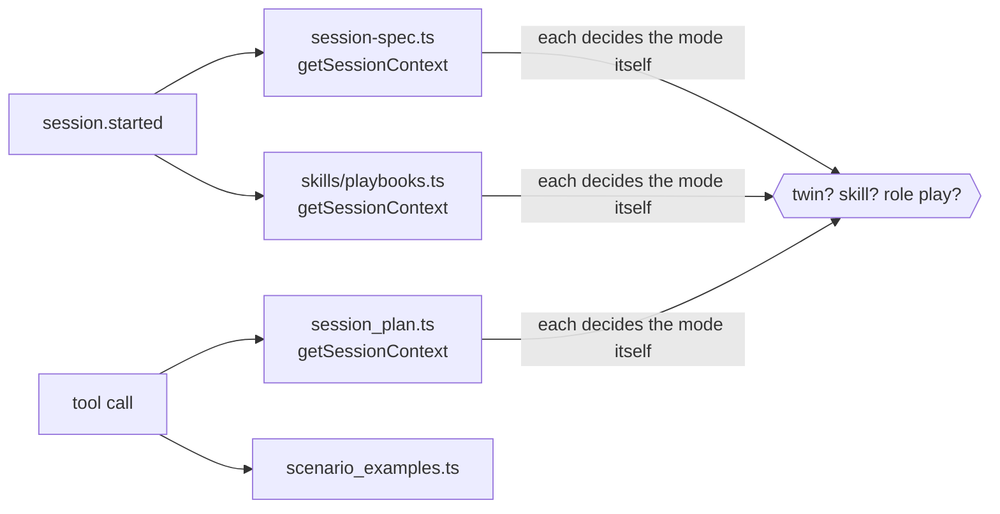
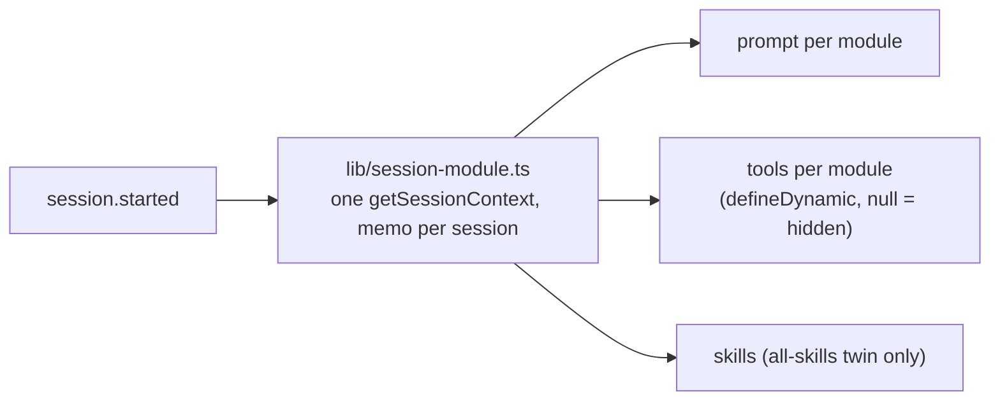

# Chat brain (`chat/`) for twin and role play — plan

**Status:** proposal, 2026-10-27. Nothing changed in `chat/` yet beyond the kind work already committed
(`agent.kind` decides the mode, pinned skills, `scenario_examples` scoped to the session).

---

## 1. Where it stands

The brain has three modes, picked from `agent.kind` + `data.source`:

| Agent | Mode in chat | Prompt | Tools the model can call |
|---|---|---|---|
| `ROLEPLAY` (interview) | interview flow | full base instructions + SESSION DATA | **all** |
| `TWIN`, all skills | twin advisor | core instructions + `formatTwinSession`; skills via `eve__skill` | **all** |
| `TWIN`, one skill | **coaching playbook** (AI runs the SKILL.md steps) | core + `formatPlaybookSession` | **all** |

## 2. Problems

| # | Problem | Effect |
|---|---|---|
| P1 | Every tool is offered in every mode; only the prompt says "don't call" | A twin can call `session_plan`, résumé tools, MCQ/code/canvas tools, `search_knowledge`; a role play can call `scenario_examples` |
| P2 | `finish_session`'s description is interview-only ("NEVER before `session_plan` reports finish") | Twin sessions never call `session_plan`, so a model that follows the tool text never ends the call cleanly |
| P3 | A **skill twin runs as a coaching session**: the AI leads the steps, plays the trainer, the learner plays the learner | Contradicts the twin module: learners ask, the twin answers (twin pages: "Questions your learners asked", "Who asks", "Most asked") |
| P4 | The mode is worked out in 3–4 places, each with its own studio call | Easy to drift; extra round-trips at session start |
| P5 | Twin settings (`data.twinSettings`: screen share before, upload before / during) are saved but not read | The switches on the Configure page do nothing in a session |
| P6 | Calibration ratings are saved but never reach the twin | Trainers rate replies, the twin doesn't learn from them |
| P7 *(web)* | Twin sessions are reported with the interview evaluator (scores, role mastery) | Twin pages expect topics and questions, not an interview score |

Role play needs **no change now**: v2 role plays are interview agents and the interview flow is right for them.
The client role-play mode (`feat/client-roleplay-mode`) comes when that branch is merged (see §5).

## 3. Proposed design

One place decides the module; tools and prompts follow it.

### 3.1 `agent/lib/session-module.ts` (P4)

`sessionModule(ctx) → { module: "roleplay" | "twin-all" | "twin-skill", context }`, one studio call per session,
kept in memory by session id. `session-spec.ts`, `skills/playbooks.ts`, `session_plan.ts`,
`scenario_examples.ts` and the tool gates all read it.

### 3.2 Tools per module (P1, P2) — eve `defineDynamic` tools, `null` hides a tool from the model

| Tool | Role play | Twin (all / skill) |
|---|---|---|
| `session_plan`, résumé tools (`start_resume_question`, `present_pending_resume_question`, `list_resume_claims`, `get_resume_claim`) | ✅ | ❌ |
| workspace tools (`surface`, `workspace_request`, canvas / code / choice / presentation / whiteboard) | ✅ (as advertised by the client) | ❌ (see 3.4) |
| `search_knowledge` | ✅ | ❌ (twin answers from its skills) |
| `search_style` | ✅ | ✅ (sounds like the trainer) |
| `scenario_examples` | ❌ | ✅ |
| `read_document` | ✅ | only when uploads are on (3.4) |
| `finish_session` | ✅ interview text (two-beat closing via `session_plan`) | ✅ twin text: "learner says they're done → confirm → next turn finish, no speech" |

### 3.3 Skill twin = advisor on one skill (P3) — **decision D1**

`twin-skill` uses the twin advisor prompt (`formatTwinSession`) with its one skill inline instead of a catalog:
the learner brings a situation, the twin answers the way the trainer would, using that skill and
`scenario_examples` for its lines. Opening: one short greeting naming the use case ("…ask me about off-plan
sales"). `formatPlaybookSession` stays only for a learner who asks to rehearse ("let's practise it") — the
existing "run a role play only if asked" rule.

### 3.4 Twin settings (P5) — **decision D3**

| Setting | Chat | Web session screen |
|---|---|---|
| Upload during the conversation | `read_document` offered; ATTACHED ARTIFACTS listed | upload button in the call |
| Upload / screen share before the start | documents listed in SESSION DATA | pre-join step shows them |
| Screen share | screen notes (voice agent `ScreenFeedbackRuntime`) are used as context | share button |

The chat half is small; the web session screen half is real UI work.

### 3.5 Calibration guidance (P6) — **decision D2**

`getSessionContext` adds, for twin sessions, the latest rated replies of that twin (cap ~10, newest first).
The twin prompt gets a block "HOW THE TRAINER WANTS YOU TO ANSWER": liked replies as examples of tone and
length, "feels off" replies as things to avoid. Web: one query; chat: one prompt block. No reasons exist yet
(the UI only has like / off).

### 3.6 Twin reports (P7, web side) — **decision D4**

`generate-session-report.ts` gets a twin branch: summary, topics (`summaryTags`), the questions asked, what the
twin could not answer; no score. The twin session page already shows topics.

## 4. Order of work

| Step | Scope | Needs |
|---|---|---|
| 1 | `session-module.ts`; move session-spec / playbooks / session_plan / scenario_examples onto it | — |
| 2 | Tool gating per module; twin `finish_session` text | step 1 |
| 3 | Skill twin as advisor | step 1, D1 |
| 4 | Calibration guidance (web query + prompt block) | D2 |
| 5 | Twin settings (chat half; web session screen half) | D3 |
| 6 | Twin reports (web) | D4 |

Steps 1–2 fix real bugs and change nothing visible for role plays. Each step ships on its own.

**Tests:** module resolution per agent kind/source; the tool set per module (role play keeps every tool it has
today); prompt tests for twin-all / twin-skill openings and the calibration block; existing chat tests unchanged
for role plays. A voice smoke call per module before release.

## 5. Later: client role play

When `feat/client-roleplay-mode` is merged, a fourth module `roleplay-client` (data: `config.scenario.roleplay`):
its `CLIENT ROLE-PLAY MODE` prompt and `end_call` tool come from that branch, and in 3.2 it hides
`search_style`, `search_knowledge`, résumé tools and `session_plan`. The module resolver from step 1 is where it plugs in.

## 6. Decisions

| # | Question | Recommendation |
|---|---|---|
| D1 | Should a skill twin be an advisor on its one skill (learner asks) instead of a coaching session the AI leads? | **Yes** — that is the twin use case; rehearsing stays available on request |
| D2 | Feed calibration ratings into the twin's prompt now? | **Yes, now** — small, and it is why trainers calibrate |
| D3 | Wire the twin settings (uploads, screen share) now? | **Chat half with step 2; web screen half separately** |
| D4 | Twin session report without a score? | **Yes** (web) |
