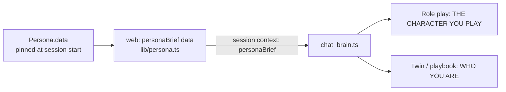

# Persona in the chat prompt: plan

## 1. Where it stands

- Web already sends the persona to chat. `getSessionContext` returns `persona.data`, pinned to the version the session started with (`lib/session-context.ts`).
- Chat reads only `name`, plus two old keys (`style`, `decision_preferences`) that the new personas don't have (`chat/agent/lib/brain.ts:390`). Everything the editor saves is dropped.
- The persona appears in three prompt formats, each with the same `PERSONA` block:
  - role play (generic agent spec);
  - skill playbook session;
  - twin ("Ask Olga").

## 2. Design



- **Web renders the brief; chat only places it.**
  - The option meanings already live in `web/lib/persona.ts` (the editor shows them), so we don't copy them into chat.
  - Chat can't import `shared/` today, and web is deployed first.
- **One renderer for every module.** Only the heading changes:
  - role play: the AI plays this person (a client, a manager);
  - twin: the AI *is* the trainer.
- **Rendered from the pinned snapshot**, so editing a persona mid-session doesn't change a live session.
- **Fallback:** without `personaBrief` (an old web build, or a global interview persona with `style` / `decision_preferences`), chat keeps today's line.

### The brief (example: Rohan Mehta)

```
THE CHARACTER YOU PLAY
- Rohan Mehta, Prospect, 41, based in Dubai Marina.
- Background: <background>
- Personality: Skeptical & Reserved: doubts what they hear, gives little away and needs proof before engaging.
- When the call opens: Skeptical: guarded; wants to know who is calling and why before giving any time.
- How they talk: <formality meaning>. <answer length meaning, e.g. "1–2 sentences">. <interrupts meaning>. <pauses / fillers meaning>.
- In their own words: <how_they_talk>
- Lines they come back to, in their own words and not every turn: "…", "…"
- Stay in character. This person decides HOW you speak; the scenario or skill decides WHAT you do.
```

- Empty fields are left out; nothing is invented.
- Voice mode: the answer-length meaning matters most (Long = 3–4 sentences).

### Field → prompt

| Stored key | Rendered as |
|---|---|
| `name`, `role`, `age`, `based_in` | One identity line |
| `background` | As written |
| `behaviours[]` | Label: meaning (max 3) |
| `opening_style` | Meaning |
| `mannerisms.formality / answer_length / interrupts / pauses / fillers` | Meanings, in one "how they talk" line |
| `how_they_talk` | As written ("in their own words") |
| `signature_phrases[]` | Quoted, "not every turn" |
| `settings.pace` | **Not in the prompt.** Program setting (TTS, later) |

## 3. Steps

1. **web `lib/persona.ts`**: `personaBrief(data, { as: "character" | "self" })`, plus a unit test covering each field, omitting empty fields, and using the meanings.
2. **web `lib/session-context.ts`**: add `personaBrief`, built from the pinned `persona.data`; `as` comes from the agent kind (TWIN → self). Extend the session-context test.
3. **chat `lib/brain.ts`**: put the brief into the three `PERSONA` blocks and fall back to today's line when it's absent. Add a test with the brief, and without it (old personas unchanged).
4. **Smoke test**: a text session each for Olga's twin and for a Rohan role play; check the system prompt contains the brief.

Deploy order: web, then chat (chat tolerates a missing brief).

## 4. Not in this plan

- Pace → TTS.
- An option set for interviewers / coaches (presets README "Gaps").
- Ingestion (separate plan, after the questions in chat are answered).
- Tool gating (`plans/chat-twin-roleplay.md`).

## 5. Decisions

| # | Question | Decision |
|---|---|---|
| P1 | If persona and skill disagree on style, which wins? | **Persona wins on manner** (length, formality, phrases); **skill wins on content** (steps, rules) |
| P2 | What does the trainer's own persona (`isOwn`) send? | **Identity only** (who, role, based in, background), everywhere (twin and role play). Her voice is the cloned voice and her behaviour comes from her skills; manner fields would only conflict |

The brief kind comes from `Persona.isOwn` (own → `self`, otherwise `character`), not from the agent kind.

**Done:** web `personaBrief` + session context (tests in `tests/lib/persona.test.ts`); chat `personaLines` in all three formats (tests in `chat/tests/agent/lib/playbook.test.ts`).
