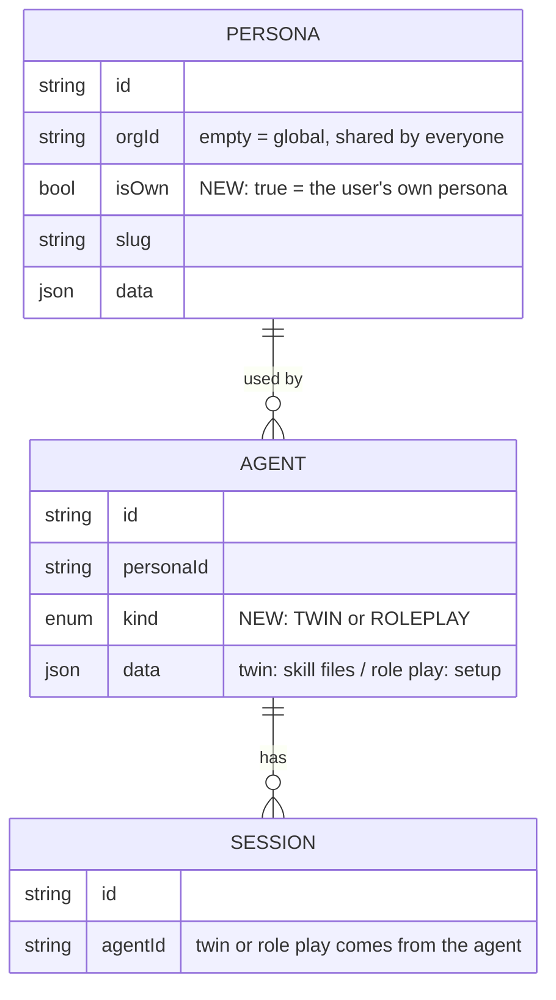
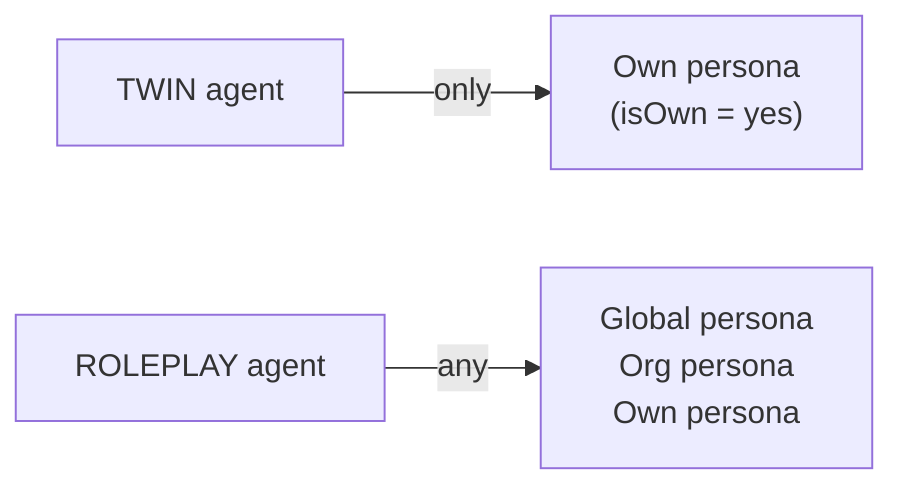
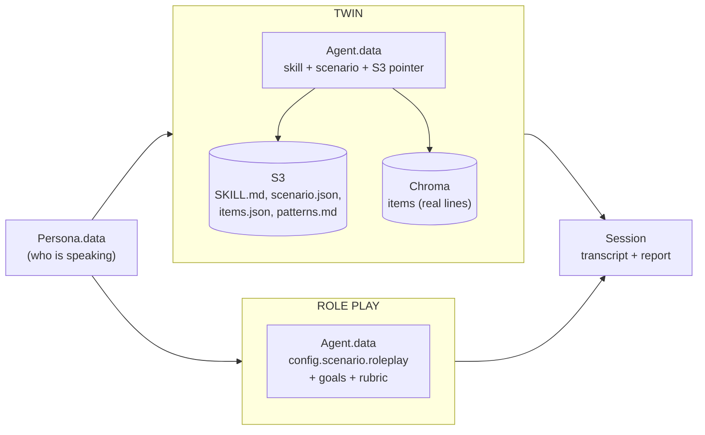
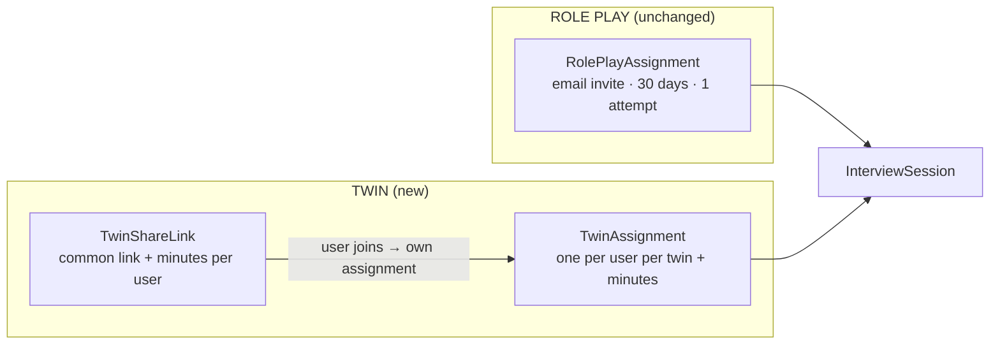
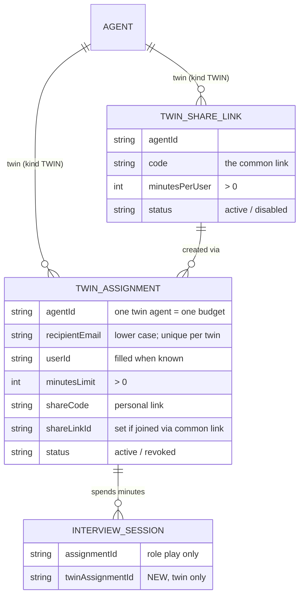

# Twin / Role play — DB split plan

**Status:** Phases 1–3 implemented 2026-10-27 (see §0). Built on `plans/twin-content-inventory.md`.
**Base:** `v2` only. Nothing is merged from `origin/feat/client-roleplay-mode` for now; its shapes are referenced only as the future role play format.


## 0. Implementation status (2026-10-27)

| Phase | Migration | State |
|---|---|---|
| 1. kind + isOwn | `20261027000000_split_twin_roleplay` | ✅ applied locally, tested |
| 2. roles admin / team / user | `20261027010000_org_roles` | ✅ applied locally, tested |
| 3. twin access + minutes | `20261027020000_twin_access` | ✅ applied locally, tested |

**Tests:** `web/tests/sql/{kind-invariants,org-roles,twin-access,assigned-learner-session}.sql` (run with
`psql -v ON_ERROR_STOP=1 -f`), `web/tests/lib/twin-access.test.ts`, updated `runnable-agent`, `scenario-ingest`,
`org-lock`, `assigned-activation`, `learner-session-access`; chat `twin`/`playbook` tests; agent `test_minutes_limit.py`.

**Differences from the design below:**
- Global uniqueness uses the existing unique indexes rebuilt `NULLS NOT DISTINCT` (Persona, SpecVersion) instead of a
  partial index, so Prisma sees no drift. Needs Postgres 15+.
- `tt_twin_access_kind()` uses a nested `IF`: PL/pgSQL resolves `NEW."shareLinkId"` even inside `AND`, which broke every
  share-link insert (caught by `twin-access.sql`).
- twin_access runs the extended `enforce_interview_session_org()` **before** converting old invites, and creates the twin
  triggers **after**, so production history (non-member learners, old chat sessions) does not block the migration.
- Minutes use `now() AT TIME ZONE 'UTC'`: timestamps are naive UTC and the DB session time zone may differ.
- better-auth roles live in `web/lib/auth-roles.ts` (shared by server and client); `creatorRole: "admin"`.
- First start through a role-play invite, twin assignment or twin link gives the learner a `member` row (role `user`).

**Code map:** `web/lib/twin-access.ts` (access + minutes + studio management), `activateSession` in
`web/lib/interview-sessions.ts`, `ends_at` in LiveKit metadata (`lib/livekit.ts`, `lib/session-activation.ts`,
`agent/src/agent.py`), `/s/[code]` page, `/api/twins/[slug]/assignments` (GET, PUT, PATCH) and
`/api/twins/[slug]/share-links` (GET, POST, PATCH), `sendTwinAssignmentEmail`.

**Deploy order:** web migrations and web first, then chat (chat reads `agent.kind` from `getSessionContext`), then the
voice agent. Dry-run the three migrations on a prod dump first.

**Follow-ups (done 2026-10-27):**
- An all-skills twin session pins its skills at start (`compiledSnapshot.twinSkills`: slug + version); the prompt,
  the eve skills and `scenario_examples` use that list, reading a re-ingested skill's older SKILL.md from SpecVersion.
  Items in Chroma hold only the latest version, so example lines of a re-ingested skill are the new ones.
- Lists are per module: `/agents`, `/sessions` and `/learners` show role plays; `SessionsList`, `listLearners` and
  `listSpecSummaries` take a kind for the twin pages. The portal catalog lists role plays only; the talk page shows a
  `user` only the twins assigned to them (admin and team see everything).
- The voice agent says a short goodbye 20 s before the minutes run out, turns the learner's mic off, and ends at the
  limit (calls under 40 s just end). The line is fixed English for now.
- `web/scripts/create-cwv-scenarios.ts` creates its agents as `ROLEPLAY`.

---

## 1. In one line

Add **two columns**: `Agent.kind` (TWIN or ROLEPLAY) and `Persona.isOwn` (is this the user's own
persona). Everything else stays where it is.



- **Agent** belongs to one module (`kind`).
- **Persona** belongs to no module. It's a shared library: global, the org's own characters, or the user's own persona.
- **Session, domain and version history** are shared. Their module comes from their agent.
- **Access and usage are NOT shared.** Twin and role play have different assign/access and usage rules. See §12.

---

## 2. Decisions

| # | Question | Decision |
|---|---|---|
| D1 | Interview agents (AI-led interviewer) | **ROLEPLAY.** They use the global `neutral-technical-interviewer` persona. |
| D2 | Ingested skills | Each skill is a **TWIN** agent, and the all-skills twin is also TWIN. |
| D3 | Access and usage rules | **Different per module.** Defined in §12. |
| D4 | Merge the roleplay branch? | **No.** Work in v2 only. |
| D6 | Global agents (`Agent.orgId` empty) | **No change.** They only get the `kind = ROLEPLAY` label from the backfill; how they behave stays the same. |
| D5 | Should `isOwn` record which user it belongs to (`userId`)? | Not now. Trainers like Olga may have no account. Easy to add later. |

---

## 3. What exists today (local DB)

| Agent rows | Count | Persona | Sessions |
|---|---|---|---|
| Interview (authored) | 10 | `neutral-technical-interviewer` (global) | 0 |

Note: these 10 agents are **global too** (`Agent.orgId` empty). That's why they pass today's
same-org trigger. See §8 step 5.
| Skill twins (`source: scenario-ingest`) | 3 | olga / vasanth (org) | 3 |
| All-skills twin (`source: twin`) | 1 | olga (org) | 8 |

| Persona | orgId | Agents |
|---|---|---|
| neutral-technical-interviewer | global | 10 |
| vasanth | global | 0 (an unused copy with the same slug as the org's; see §6) |
| olga | org | 3 |
| vasanth | org | 1 |

---

## 4. Example rows after the change

**Persona**

| slug | orgId | isOwn | What it is |
|---|---|---|---|
| neutral-technical-interviewer | *(empty)* | no | Global, shared by all orgs |
| daniel | *(empty)* | no | Global role-play client |
| olga | org-1 | **yes** | User's own: real voice, recordings |
| my-custom-buyer | org-1 | no | Character the org made |

**Agent**

| slug | kind | persona | What it is |
|---|---|---|---|
| org-olga-twin | TWIN | olga | Olga's twin with all her skills |
| org-objection-handling | TWIN | olga | One skill |
| wait-and-see-investor | ROLEPLAY | daniel | Sales role play |
| react-interview-round-1 | ROLEPLAY | neutral-technical-interviewer | Interview practice |

---

## 5. Rules



1. A twin must use an own persona. *(trigger)*
2. A role play can use any persona.
3. A global persona is never someone's own. *(CHECK)*
4. `Agent.kind` and `Persona.isOwn` never change after the row is created. *(trigger)*
5. Global persona slugs are unique. *(partial unique index)*
6. `Agent.kind` has no default, so every create must set it. *(TypeScript fails at compile time otherwise)*

---

## 6. Global personas

| Topic | Rule |
|---|---|
| Who creates them | Developers only, through a seed or script (same as sample voices). No UI. |
| Lookup | Org persona first, then global, using the `OR: [{ orgId }, { orgId: null }]` pattern `Voice` already uses. Twin code paths filter to `isOwn` only. |
| Editing | Orgs can't edit a global persona. To change one, they copy it into the org. |
| Past sessions | Safe: sessions pin `personaSlug` and `personaVersion`. |
| Recordings, style, cloned voice | Own personas only (`PersonaSource`, Chroma `persona_<id>`). |
| Knowledge | A global persona can't point at one org's documents. Knowledge goes on the org's copy or on the role play. |
| Slug clash | Global `vasanth` and org `vasanth` both exist today. The lookup rule above resolves it. The unused global copy can be removed. |
| SpecVersion | Same NULL-`orgId` uniqueness gap. Add the same kind of partial unique index. |
| Branch seeds (Daniel, Priya…) | Become one global set. Rows already created per org stay as org characters. |

---

## 7. Where each module's data lives



### Twin

| What | Where |
|---|---|
| How it was made | `Agent.data.source`: `scenario-ingest` (one skill) or `twin` (all skills) |
| SKILL.md | `Agent.data.skill` + S3 |
| Steps and moves | `Agent.data.scenario` + S3 (`scenario.json`) |
| Real example lines | S3 `items.json` + Chroma `scenario_item` records |
| Evidence notes | S3 `patterns.md` only (never shown to learners) |
| Pointer to files | `Agent.data.artifacts` → `{org}/scenario-ingest/scenarios/{slug}/v{n}/` |
| Voice / intro video | `Agent.data.voiceId`, `Agent.data.introVideo` |
| Speaking style | Own persona + Chroma `persona_<id>` |

### Role play (the roleplay branch's shape, all in `Agent.data`)

| What | Where |
|---|---|
| Situation, hidden truth, learner role | `config.scenario.roleplay.situation` |
| Agrees / declines when | `config.scenario.roleplay.situation.agrees_when / declines_when` |
| Client behavior (difficulty, how they talk, reactions) | `config.scenario.roleplay.agent` |
| Learner goals (≤5) | `stages[0].config.evidence.definitions` |
| Scoring rubric | `config.scenario.roleplay.rubric` |
| Opening line | `opening` |
| Interview setup (D1) | `config.interview` |

No S3 files or Chroma items are needed. A role play is one JSON block.

### Shared

| What | Where | Twin | Role play |
|---|---|---|---|
| Transcript | `InterviewSession.transcript` | ✅ | ✅ |
| Pinned versions | `InterviewSession.compiledSnapshot` | ✅ + **list of skills (new)** | ✅ |
| Report | `InterviewSession.report` | Light summary | Score, pass/fail, goals, rubric |
| Recording | `s3AudioKey` / egress | ✅ | ✅ |

**Why `Agent.data` and not new tables:** the runtime and the version history (`SpecVersion`) already read
and save `Agent.data`. Each module validates its own block with its own zod schema.
**Upgrade path:** when one module's data grows (for example twin likes/dislikes, or role play score
analytics), add a 1:1 table keyed by `agentId`.

---

## 8. Migration SQL (`2026xxxxxxxxxx_split_twin_roleplay`, one transaction)

```sql
-- 1. add columns
CREATE TYPE "agent_kind" AS ENUM ('TWIN', 'ROLEPLAY');
ALTER TABLE "Agent"     ADD COLUMN "kind" "agent_kind";
ALTER TABLE "SpecDraft" ADD COLUMN "kind" "agent_kind";
ALTER TABLE "Persona"   ADD COLUMN "isOwn" boolean;

-- 2. fill from today's data
UPDATE "Agent" SET "kind" = CASE
  WHEN data->>'source' IN ('twin', 'scenario-ingest') THEN 'TWIN'
  ELSE 'ROLEPLAY' END::"agent_kind";
UPDATE "SpecDraft" SET "kind" = 'ROLEPLAY'; -- ingest never drafts
UPDATE "Persona" SET "isOwn" = ("orgId" IS NOT NULL AND coalesce(data->>'kind', '') <> 'client');

-- 3. lock down
ALTER TABLE "Agent"     ALTER COLUMN "kind"  SET NOT NULL;
ALTER TABLE "SpecDraft" ALTER COLUMN "kind"  SET NOT NULL;
ALTER TABLE "Persona"   ALTER COLUMN "isOwn" SET NOT NULL;
ALTER TABLE "Persona"   ALTER COLUMN "isOwn" SET DEFAULT false;
ALTER TABLE "Persona"   ADD CONSTRAINT persona_global_not_own CHECK (NOT ("isOwn" AND "orgId" IS NULL));
CREATE UNIQUE INDEX "Persona_global_slug_key" ON "Persona"(slug) WHERE "orgId" IS NULL;
CREATE INDEX "Agent_orgId_kind_idx"     ON "Agent"("orgId", "kind");
CREATE INDEX "Agent_personaId_kind_idx" ON "Agent"("personaId", "kind");
CREATE INDEX "SpecDraft_orgId_kind_idx" ON "SpecDraft"("orgId", "kind");

-- 4. rules the app can't break
CREATE FUNCTION tt_immutable() RETURNS trigger LANGUAGE plpgsql AS $$
BEGIN
  RAISE EXCEPTION '%.% cannot change', TG_TABLE_NAME, TG_ARGV[0];
END $$;
CREATE TRIGGER agent_kind_immutable BEFORE UPDATE OF "kind" ON "Agent"
  FOR EACH ROW WHEN (OLD."kind" IS DISTINCT FROM NEW."kind") EXECUTE FUNCTION tt_immutable('kind');
CREATE TRIGGER persona_isown_immutable BEFORE UPDATE OF "isOwn" ON "Persona"
  FOR EACH ROW WHEN (OLD."isOwn" IS DISTINCT FROM NEW."isOwn") EXECUTE FUNCTION tt_immutable('isOwn');

CREATE FUNCTION tt_twin_needs_own() RETURNS trigger LANGUAGE plpgsql AS $$
BEGIN
  IF NEW."kind" = 'TWIN' AND NOT (SELECT "isOwn" FROM "Persona" WHERE id = NEW."personaId") THEN
    RAISE EXCEPTION 'twin % must use the user''s own persona', NEW.slug;
  END IF;
  RETURN NEW;
END $$;
CREATE TRIGGER agent_twin_needs_own BEFORE INSERT OR UPDATE OF "kind", "personaId" ON "Agent"
  FOR EACH ROW EXECUTE FUNCTION tt_twin_needs_own();

-- 5. let org agents use global personas.
-- The existing trigger (migration 20260908152000) requires agent.orgId = persona.orgId, which blocks
-- an org role play from using a global persona like Daniel.
CREATE OR REPLACE FUNCTION enforce_agent_persona_org() RETURNS trigger LANGUAGE plpgsql AS $$
BEGIN
  IF NOT EXISTS (
    SELECT 1 FROM "Persona"
    WHERE id = NEW."personaId" AND ("orgId" IS NOT DISTINCT FROM NEW."orgId" OR "orgId" IS NULL)
  ) THEN
    RAISE EXCEPTION 'Agent persona must belong to the same organization or be global';
  END IF;
  RETURN NEW;
END $$;
```

**Tested 2026-10-26** on the local DB inside `BEGIN … ROLLBACK`: the backfill classified 10 ROLEPLAY and 4 TWIN agents,
all 11 sessions are TWIN, and the personas came out as olga and vasanth (org) `isOwn = true`, the two
global ones `false`. Every rule fired: kind change, isOwn change, own+global, twin on a character, twin on a
global persona, and another org's persona were all rejected; an org role play on a global persona was allowed.

Prisma doesn't track triggers, CHECKs or partial indexes. They live only in this migration file.
The two existing global personas get `isOwn = false`, which satisfies the CHECK.

**Prisma schema:** `enum AgentKind { TWIN ROLEPLAY @@map("agent_kind") }`;
`Agent.kind AgentKind` (no default); `SpecDraft.kind AgentKind` (no default);
`Persona.isOwn Boolean @default(false)`; plus the three `@@index` lines.

---

## 9. Code that has to change

**Writers that must set the new values** (the compiler finds them once `kind` has no default):

| File | Sets |
|---|---|
| `web/lib/twins.ts:90` `ensureTwin` | `kind: TWIN` |
| `web/lib/scenario-ingest.ts:215` `ingestScenario` | `kind: TWIN` |
| `web/lib/spec-drafts.ts:62` draft create | caller's kind |
| `web/lib/spec-drafts.ts:161` publish | `kind: draft.kind` |
| `web/lib/specs.ts:318` persona create | `isOwn` (new parameter) |
| `web/scripts/create-cwv-scenarios.ts:562` | `kind: ROLEPLAY` |
| Roleplay-branch writers (client persona store, builder) | `kind: ROLEPLAY`, `isOwn: false` |

**Readers that stop reading `data.source` to decide the module:**

| File | Change |
|---|---|
| `web/lib/specs.ts:122, 187-189` | use `agent.kind` |
| `web/lib/session-context.ts:135` | `kind === TWIN`, then save the skill list into `compiledSnapshot` |
| `web/app/api/copilot/studio/route.ts:239` | use `agent.kind` |
| `web/lib/twins.ts:40` | `where: { kind: TWIN, personaId }` + `data.skill` |
| `chat/agent/lib/brain.ts:43,75`, `chat/agent/skills/playbooks.ts:24` | use `agent.kind` (`getSessionContext` must return it) |
| 17 `db.persona.*` reads | org-then-global lookup; twin paths filter `isOwn` |
| List pages (agents, sessions, learners, personas) | filter by `kind`, or through `agent.kind` |

`data.source` stays, but only to tell one skill from all skills inside the twin module.

---

## 10. Rollout

1. v2 only, no merge.
2. Save the counts from §11 query A.
3. Add the migration, then `prisma generate`, then fix the writers and readers in §9.
4. Run §11 on local, then on a prod dump, then on prod.
5. Rollback (before new writes): drop the triggers, functions, constraint, indexes, columns and type,
   and restore the original `enforce_agent_persona_org()` from migration `20260908152000`.

---

## 11. Checks

```sql
-- A. every agent classified as expected (run before and after)
SELECT coalesce(data->>'source', '(authored)') AS src, kind, count(*) FROM "Agent" GROUP BY 1, 2;
-- B. no twin on a persona that isn't own: expect 0
SELECT count(*) FROM "Agent" a JOIN "Persona" p ON p.id = a."personaId"
WHERE a.kind = 'TWIN' AND NOT p."isOwn";
-- C. sessions per module (sum = total sessions)
SELECT a.kind, count(*) FROM "InterviewSession" s JOIN "Agent" a ON a.id = s."agentId" GROUP BY 1;
-- D. each must ERROR (run inside BEGIN … ROLLBACK)
UPDATE "Agent" SET kind = 'ROLEPLAY' WHERE kind = 'TWIN';
UPDATE "Persona" SET "isOwn" = NOT "isOwn";
INSERT INTO "Persona"(id, slug, name, data, "isOwn", "updatedAt") VALUES ('x', 'x', 'x', '{}', true, now());
```

Keep D as a self-check in `web/tests/sql/kind-invariants.sql`.

---

## 12. Access and usage (second migration, `2026xxxxxxxxxx_twin_access`)

### Decisions (2026-10-26)

| | Twin | Role play |
|---|---|---|
| Who | Assigned per user | Assigned per user (today's rules, unchanged) |
| Limit | **Minutes per assignment**; each twin agent (all-skills or a skill twin) has its own budget | None by time. The limit is part of the role play itself: attempts (today: 1) |
| At the limit | **Blocked** | Invite becomes `used` (today) |
| Shareable link | **Yes**: one common link per twin, each user who joins gets their own assignment | No (personal invites only) |
| Mode | **Voice only** (all sessions go through LiveKit) | Unchanged |
| Owner | **No limits**, no assignment needed | Unchanged |
| Expiry | None for now | 30 days (today) |
| Existing twin invite | The one pending invite on `acme-objection-handling-roleplay` becomes a twin assignment with **30 minutes**, keeping the same link | — |

### Tables





**Minutes used** are computed from the sessions, so there's no separate counter that could drift:

```sql
SELECT coalesce(sum(extract(epoch FROM (
  coalesce("endedAt", CASE WHEN status IN ('activating', 'active') THEN now() AT TIME ZONE 'UTC' ELSE "startedAt" END)
  - "startedAt"))), 0) / 60 AS minutes_used
FROM "InterviewSession" WHERE "twinAssignmentId" = $1 AND "startedAt" IS NOT NULL;
```

A session that ended without `endedAt` (crashed, failed) counts as 0, not as an ever-growing number.

### Rules (enforced by the database)

| Rule | How |
|---|---|
| Role-play invites only on role plays | trigger on `RolePlayAssignment` |
| Twin assignments and links only on twins of the same org | trigger on `TwinAssignment` and `TwinShareLink` |
| A link-made assignment is for that link's twin | same trigger |
| One assignment per user per twin; opening the link again reuses it | unique `(agentId, recipientEmail)` |
| Email stored lower case; minutes > 0 | CHECK |
| Twin sessions are voice only | trigger on `InterviewSession` |
| A twin session without an assignment is allowed for owners only | same trigger (`'owner'` in the member's role list) |
| A twin assignment can only be used by its own user, on its own twin | extended `enforce_interview_session_org()` |
| Twin-link joiners don't need to be org members | same function: a twin assignment counts as access, like a role-play invite |
| A session has a role-play invite **or** a twin assignment, never both | CHECK `session_one_assignment_kind` |

### Migration SQL

```sql
-- ===== Twin access: tables =====
CREATE TABLE "TwinShareLink" (
  "id"              TEXT PRIMARY KEY,
  "orgId"           TEXT NOT NULL REFERENCES "organization"("id") ON DELETE CASCADE,
  "agentId"         TEXT NOT NULL REFERENCES "Agent"("id") ON DELETE CASCADE,
  "code"            TEXT NOT NULL UNIQUE,
  "minutesPerUser"  INTEGER NOT NULL CHECK ("minutesPerUser" > 0),
  "status"          TEXT NOT NULL DEFAULT 'active' CHECK ("status" IN ('active', 'disabled')),
  "createdByUserId" TEXT,
  "createdAt"       TIMESTAMP(3) NOT NULL DEFAULT CURRENT_TIMESTAMP,
  "updatedAt"       TIMESTAMP(3) NOT NULL
);
CREATE INDEX "TwinShareLink_agentId_idx" ON "TwinShareLink"("agentId");

CREATE TABLE "TwinAssignment" (
  "id"               TEXT PRIMARY KEY,
  "orgId"            TEXT NOT NULL REFERENCES "organization"("id") ON DELETE CASCADE,
  "agentId"          TEXT NOT NULL REFERENCES "Agent"("id") ON DELETE CASCADE,
  "recipientEmail"   TEXT NOT NULL CHECK ("recipientEmail" = lower("recipientEmail")),
  "userId"           TEXT REFERENCES "user"("id") ON DELETE SET NULL,
  "minutesLimit"     INTEGER NOT NULL CHECK ("minutesLimit" > 0),
  "shareCode"        TEXT NOT NULL UNIQUE,
  "shareLinkId"      TEXT REFERENCES "TwinShareLink"("id") ON DELETE SET NULL,
  "assignedByUserId" TEXT,
  "status"           TEXT NOT NULL DEFAULT 'active' CHECK ("status" IN ('active', 'revoked')),
  "createdAt"        TIMESTAMP(3) NOT NULL DEFAULT CURRENT_TIMESTAMP,
  "updatedAt"        TIMESTAMP(3) NOT NULL
);
CREATE UNIQUE INDEX "TwinAssignment_agentId_recipientEmail_key" ON "TwinAssignment"("agentId", "recipientEmail");
CREATE INDEX "TwinAssignment_orgId_status_idx" ON "TwinAssignment"("orgId", "status");
CREATE INDEX "TwinAssignment_userId_idx" ON "TwinAssignment"("userId");

ALTER TABLE "InterviewSession" ADD COLUMN "twinAssignmentId" TEXT
  REFERENCES "TwinAssignment"("id") ON DELETE SET NULL;
CREATE INDEX "InterviewSession_twinAssignmentId_idx" ON "InterviewSession"("twinAssignmentId");
ALTER TABLE "InterviewSession" ADD CONSTRAINT session_one_assignment_kind
  CHECK ("assignmentId" IS NULL OR "twinAssignmentId" IS NULL);

-- ===== Move existing invites on twin agents to twin assignments (30 minutes, same link) =====
INSERT INTO "TwinAssignment" ("id","orgId","agentId","recipientEmail","userId","minutesLimit","shareCode","assignedByUserId","status","createdAt","updatedAt")
SELECT r."id", r."orgId", d."agentId", lower(r."recipientEmail"), m."userId", 30, r."shareCode", r."assignedByUserId",
       CASE WHEN r."status" IN ('pending', 'used') THEN 'active' ELSE 'revoked' END, r."assignedAt", now()
FROM "RolePlayAssignment" r
JOIN "Deployment" d ON d."id" = r."deploymentId"
JOIN "Agent" a ON a."id" = d."agentId"
LEFT JOIN "member" m ON m."id" = r."memberId"
WHERE a."kind" = 'TWIN';
UPDATE "InterviewSession" s SET "twinAssignmentId" = s."assignmentId", "assignmentId" = NULL
FROM "TwinAssignment" t WHERE t."id" = s."assignmentId";
DELETE FROM "RolePlayAssignment" r USING "Deployment" d, "Agent" a
WHERE d."id" = r."deploymentId" AND a."id" = d."agentId" AND a."kind" = 'TWIN';

-- ===== Rules =====
-- Role-play invites only on role plays.
CREATE FUNCTION tt_roleplay_assignment_kind() RETURNS trigger LANGUAGE plpgsql AS $$
BEGIN
  IF NOT EXISTS (SELECT 1 FROM "Deployment" d JOIN "Agent" a ON a.id = d."agentId"
                 WHERE d.id = NEW."deploymentId" AND a.kind = 'ROLEPLAY') THEN
    RAISE EXCEPTION 'Role-play assignments are only for role plays';
  END IF;
  RETURN NEW;
END $$;
CREATE TRIGGER roleplay_assignment_kind BEFORE INSERT OR UPDATE OF "deploymentId" ON "RolePlayAssignment"
  FOR EACH ROW EXECUTE FUNCTION tt_roleplay_assignment_kind();

-- Twin assignments and links only on twins of the same org; a link-made assignment is for that link's twin.
CREATE FUNCTION tt_twin_access_kind() RETURNS trigger LANGUAGE plpgsql AS $$
BEGIN
  IF NOT EXISTS (SELECT 1 FROM "Agent" WHERE id = NEW."agentId" AND kind = 'TWIN' AND "orgId" = NEW."orgId") THEN
    RAISE EXCEPTION '% must point at a twin in the same organization', TG_TABLE_NAME;
  END IF;
  IF TG_TABLE_NAME = 'TwinAssignment' AND NEW."shareLinkId" IS NOT NULL AND NOT EXISTS (
    SELECT 1 FROM "TwinShareLink" WHERE id = NEW."shareLinkId" AND "agentId" = NEW."agentId") THEN
    RAISE EXCEPTION 'Twin assignment share link must be for the same twin';
  END IF;
  RETURN NEW;
END $$;
CREATE TRIGGER twin_share_link_kind BEFORE INSERT OR UPDATE OF "agentId", "orgId" ON "TwinShareLink"
  FOR EACH ROW EXECUTE FUNCTION tt_twin_access_kind();
CREATE TRIGGER twin_assignment_kind BEFORE INSERT OR UPDATE OF "agentId", "orgId", "shareLinkId" ON "TwinAssignment"
  FOR EACH ROW EXECUTE FUNCTION tt_twin_access_kind();

-- Twin sessions: voice only (LiveKit); without a twin assignment only an owner may run one (no limits).
CREATE FUNCTION tt_twin_session() RETURNS trigger LANGUAGE plpgsql AS $$
BEGIN
  IF (SELECT kind FROM "Agent" WHERE id = NEW."agentId") = 'TWIN' THEN
    IF NEW."mode" <> 'voice' THEN
      RAISE EXCEPTION 'Twin sessions are voice only';
    END IF;
    IF NEW."twinAssignmentId" IS NULL AND NOT EXISTS (
      SELECT 1 FROM "member" WHERE "userId" = NEW."userId" AND "organizationId" = NEW."orgId"
        AND 'owner' = ANY (string_to_array(replace("role", ' ', ''), ','))) THEN
      RAISE EXCEPTION 'Twin sessions need a twin assignment unless the user is an owner';
    END IF;
  END IF;
  RETURN NEW;
END $$;
CREATE TRIGGER twin_session BEFORE INSERT OR UPDATE OF "agentId", "mode", "twinAssignmentId", "userId", "orgId" ON "InterviewSession"
  FOR EACH ROW EXECUTE FUNCTION tt_twin_session();

-- Existing session org rule, extended: a twin assignment also proves access (link joiners may not be members).
CREATE OR REPLACE FUNCTION enforce_interview_session_org() RETURNS trigger LANGUAGE plpgsql AS $$
BEGIN
  IF NOT EXISTS (SELECT 1 FROM "Agent" WHERE id = NEW."agentId" AND "orgId" = NEW."orgId") THEN
    RAISE EXCEPTION 'Session agent must belong to the same organization';
  END IF;

  IF NEW."assignmentId" IS NOT NULL THEN
    IF NOT EXISTS (
      SELECT 1 FROM "RolePlayAssignment" a
      JOIN "Deployment" d ON d.id = a."deploymentId"
      JOIN "user" u ON u.id = NEW."userId"
      LEFT JOIN "member" m ON m.id = a."memberId"
      WHERE a.id = NEW."assignmentId"
        AND a."orgId" = NEW."orgId"
        AND d."orgId" = NEW."orgId"
        AND d."agentId" = NEW."agentId"
        AND (NEW."deploymentId" IS NULL OR NEW."deploymentId" = a."deploymentId")
        AND (
          (a."memberId" IS NOT NULL AND m."userId" = NEW."userId" AND m."organizationId" = NEW."orgId")
          OR (a."memberId" IS NULL AND LOWER(a."recipientEmail") = LOWER(u.email))
        )
    ) THEN
      RAISE EXCEPTION 'Session assignment must belong to the user and organization';
    END IF;
  ELSIF NEW."twinAssignmentId" IS NOT NULL THEN
    IF NOT EXISTS (
      SELECT 1 FROM "TwinAssignment" t
      JOIN "user" u ON u.id = NEW."userId"
      WHERE t.id = NEW."twinAssignmentId"
        AND t."orgId" = NEW."orgId"
        AND t."agentId" = NEW."agentId"
        AND (t."userId" = NEW."userId" OR (t."userId" IS NULL AND t."recipientEmail" = LOWER(u.email)))
    ) THEN
      RAISE EXCEPTION 'Session twin assignment must belong to the user and organization';
    END IF;
  ELSIF NOT EXISTS (
    SELECT 1 FROM "member" WHERE "userId" = NEW."userId" AND "organizationId" = NEW."orgId"
  ) THEN
    RAISE EXCEPTION 'Session user must belong to the same organization';
  END IF;

  IF NEW."contextId" IS NOT NULL AND NOT EXISTS (
    SELECT 1 FROM "ContextDocument" WHERE id = NEW."contextId" AND "orgId" = NEW."orgId"
  ) THEN
    RAISE EXCEPTION 'Session context must belong to the same organization';
  END IF;
  RETURN NEW;
END $$;
DROP TRIGGER "InterviewSession_org_check" ON "InterviewSession";
CREATE TRIGGER "InterviewSession_org_check" BEFORE INSERT OR UPDATE OF "orgId", "userId", "agentId", "contextId", "assignmentId", "deploymentId", "twinAssignmentId"
  ON "InterviewSession" FOR EACH ROW EXECUTE FUNCTION enforce_interview_session_org();
```

### Tested 2026-10-26 (local DB, on top of §8, inside `BEGIN … ROLLBACK`)

| # | Case | Result |
|---|---|---|
| 1 | Existing twin invite converted | ✅ 30 minutes, same `shareCode`, 0 role-play invites left |
| 2 | Role-play invite on a twin | ✅ rejected |
| 3 | Role-play invite on a role play | ✅ allowed |
| 4 | Twin assignment on a role play | ✅ rejected |
| 5 | Same user twice on one twin / same user on a skill twin | ✅ rejected / ✅ allowed (own budget) |
| 5c | Upper-case email, 0 minutes | ✅ both rejected |
| 6 | Twin chat session | ✅ rejected |
| 7, 8c | Owner (`owner` or `admin, owner`) without assignment | ✅ allowed |
| 8, 8b | Learner without assignment, plain member without assignment | ✅ both rejected |
| 9 | Non-member learner with their assignment | ✅ allowed |
| 10, 11 | Another user, or another twin, using that assignment | ✅ rejected |
| 12b | Both assignment kinds on one session | ✅ rejected by CHECK |
| 13 | Minutes used (6-minute session) | ✅ 6.0 of 30 |
| 14 | All 12 existing sessions pass the new triggers | ✅ |

### App work this needs (not DB)

| Where | Change |
|---|---|
| `activateSession` (`lib/interview-sessions.ts`) | Twin path: find the assignment (personal code or link join), check `active` and minutes left (block at 0), owner skips both, reject chat mode, end other active sessions on the same assignment first (no double spending) |
| LiveKit dispatch (`lib/livekit.ts`, `agent/src/agent.py`) | Pass the seconds left; the voice agent ends the call when they run out |
| `/s/[code]` | Look up the code as a role-play invite, a twin assignment, or a twin share link |
| Link join | Signed-in user → reuse or create `TwinAssignment` with `minutesLimit = link.minutesPerUser`, `shareLinkId` set |
| Session close | Always set `endedAt` (minutes depend on it) |
| Emails | Twin invite email (today only the role-play email exists) |
| Learner portal and lists | Show a twin only to users with an active assignment, plus owners |

**Prisma schema:** models `TwinAssignment` and `TwinShareLink` as in the SQL; `InterviewSession.twinAssignmentId String?`
with relation and `@@index`; back-relations on `Agent`, `Organization`, `User`. Prisma doesn't track the triggers and CHECKs.

---

## 13. Org roles: admin / team / user (third migration, `2026xxxxxxxxxx_org_roles`)

Roles stay on **`member.role`**, the org-users table. better-auth's organization plugin manages it and copies
an invitation's role onto it. A column on `user` would be a second copy that better-auth never reads.

| Role | Studio | Twin / role play |
|---|---|---|
| **admin** | full access | use; no twin minute limit, no assignment needed |
| **team** | full access, **same as admin** | same as admin |
| **user** | none | use through assignments (twin: minutes) |

Backfill: `owner` and `admin` → **admin**; `member` → **user**. Local DB result: 1 member (owner) → admin,
1 invitation (member) → user. One role per member; comma lists like `"admin, owner"` are no longer allowed.

### Migration SQL

```sql
-- ===== Org roles: admin / team / user =====
UPDATE "member" SET "role" = CASE
  WHEN "role" ~* '(^|,)\s*(owner|admin)\s*(,|$)' THEN 'admin'
  WHEN "role" ~* '(^|,)\s*team\s*(,|$)' THEN 'team'
  ELSE 'user' END;
UPDATE "invitation" SET "role" = CASE
  WHEN "role" ~* '(^|,)\s*(owner|admin)\s*(,|$)' THEN 'admin'
  WHEN "role" ~* '(^|,)\s*team\s*(,|$)' THEN 'team'
  ELSE 'user' END;
ALTER TABLE "member"     ALTER COLUMN "role" SET DEFAULT 'user';
ALTER TABLE "invitation" ALTER COLUMN "role" SET DEFAULT 'user';
ALTER TABLE "invitation" ALTER COLUMN "role" SET NOT NULL;
ALTER TABLE "member"     ADD CONSTRAINT member_role_check     CHECK ("role" IN ('admin', 'team', 'user'));
ALTER TABLE "invitation" ADD CONSTRAINT invitation_role_check CHECK ("role" IN ('admin', 'team', 'user'));

-- Twin sessions without an assignment: studio roles (admin, team) instead of owner.
CREATE OR REPLACE FUNCTION tt_twin_session() RETURNS trigger LANGUAGE plpgsql AS $$
BEGIN
  IF (SELECT kind FROM "Agent" WHERE id = NEW."agentId") = 'TWIN' THEN
    IF NEW."mode" <> 'voice' THEN
      RAISE EXCEPTION 'Twin sessions are voice only';
    END IF;
    IF NEW."twinAssignmentId" IS NULL AND NOT EXISTS (
      SELECT 1 FROM "member" WHERE "userId" = NEW."userId" AND "organizationId" = NEW."orgId"
        AND "role" IN ('admin', 'team')) THEN
      RAISE EXCEPTION 'Twin sessions need a twin assignment unless the user is admin or team';
    END IF;
  END IF;
  RETURN NEW;
END $$;

-- Learners with no member row get role 'user' in their first (oldest) org match.
-- Same rule as lib/org-lock.ts homeOrgsByEmail (earliest live role-play invite or session), plus active twin assignments.
-- Only people who already have a user row; invite-only emails get theirs on first sign-in (app work).
INSERT INTO "member" ("id", "organizationId", "userId", "role", "createdAt")
SELECT gen_random_uuid()::text, first."orgId", first."userId", 'user', first."at"
FROM (
  SELECT DISTINCT ON (m."userId") m."userId", m."orgId", m."at"
  FROM (
    SELECT s."userId", s."orgId", s."createdAt" AS "at" FROM "InterviewSession" s
    UNION ALL
    SELECT u."id", r."orgId", r."assignedAt" FROM "RolePlayAssignment" r
      JOIN "user" u ON lower(u."email") = lower(r."recipientEmail") WHERE r."status" IN ('pending', 'used')
    UNION ALL
    SELECT u."id", t."orgId", t."createdAt" FROM "TwinAssignment" t
      JOIN "user" u ON u."id" = t."userId" OR (t."userId" IS NULL AND lower(u."email") = t."recipientEmail")
      WHERE t."status" = 'active'
  ) m
  WHERE NOT EXISTS (SELECT 1 FROM "member" x WHERE x."userId" = m."userId")
  ORDER BY m."userId", m."at", m."orgId"
) first;
```

### Tested 2026-10-26 (on top of §8 and §12, inside `BEGIN … ROLLBACK`)

| Case | Result |
|---|---|
| owner → admin, member → user | ✅ |
| team / admin run a twin without an assignment | ✅ allowed |
| user runs a twin without an assignment | ✅ rejected |
| `owner`, `member`, `admin,team` written to `member.role` | ✅ all rejected by CHECK |
| New member without a role | ✅ defaults to `user` |

### App work

| Where | Change |
|---|---|
| `web/lib/auth.ts` | roles `{ admin, team, user }`, admin and team get identical statements (today's admin + apiKey); `creatorRole: "admin"` |
| `web/app/api/onboarding/route.ts:127`, `web/app/auth/onboarding/page.tsx:31` | `"owner"` → `"admin"` |
| One helper `isStudioRole(role)` in `web/lib/org.ts` | replaces the inline `["owner", "admin"]` checks in `lib/org.ts`, `lib/auth-home.ts`, `app/dash/developer`, `app/dash/users`, `app/api/org/settings`, `app/api/sessions/[id]` (+ `/video`, `/audio`), `app/api/v1/users`, `app/api/v1/assignments`, and the regex in `lib/notion-oauth.ts` |
| Learner queries and labels | `role: "member"` → `"user"` in `app/dash/agents/[slug]`, `lib/learners.ts`, `app/api/v1/users` (+ `[id]`), `components/users/invite-user.tsx`, `app/dash/users` |

**Watch:** better-auth's built-in default for `member.role` is `"member"` and applies only when code omits the role.
The CHECK turns that slip into a loud error, so every better-auth call that creates a member or invitation must pass a role.

### Learners with no role (decided 2026-10-26)

Every learner who has a `user` row but no `member` row gets role **`user`** in their **first (oldest) org match**.
"Match" uses the same rule as the single-org lock (`lib/org-lock.ts` `homeOrgsByEmail`): live role-play invites
(`pending`/`used`) and sessions, plus active twin assignments. The member's `createdAt` is set to that match time, and
cancelled or expired invites never count. Running it again adds nothing.

Local DB: 0 such learners. Run this on a prod dump first to see the count:

```sql
SELECT count(DISTINCT u.id) FROM "user" u
WHERE NOT EXISTS (SELECT 1 FROM "member" m WHERE m."userId" = u.id)
  AND (EXISTS (SELECT 1 FROM "InterviewSession" s WHERE s."userId" = u.id)
    OR EXISTS (SELECT 1 FROM "RolePlayAssignment" r WHERE lower(r."recipientEmail") = lower(u.email) AND r.status IN ('pending', 'used')));
```

Tested with test data (two orgs, inside `BEGIN … ROLLBACK`):

| Learner | Situation | Result |
|---|---|---|
| L1 | org2 invite (oldest) + org1 twin assignment | ✅ `user` in org2 |
| L2 | org1 twin assignment only | ✅ `user` in org1 |
| L3 | cancelled invite only | ✅ no member row |
| L4 | already a member, plus an older invite elsewhere | ✅ unchanged |
| — | invite email with no user row | ✅ nothing |
| — | second run | ✅ `INSERT 0 0` |

**App work for this:** create the `member` row (role `user`) when a learner first signs in through an invite or a twin link,
so nobody new ends up without a role. Add `TwinAssignment` to `homeOrgsByEmail` so the lock knows about twin access.
Learners with invites in more than one org keep them, but the lock already blocks the non-home org (unchanged).
