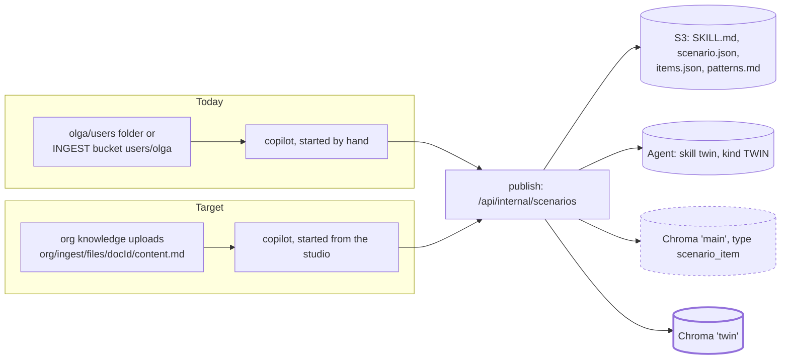

# Twin skills from the knowledge base: plan

## 1. The model (agreed)

- The trainer uploads everything (sessions, method docs) to the knowledge base. Uploads are stored only: the original plus Markdown. Nothing is built automatically.
- A **skill is built only when someone asks for one**. The copilot (ingestion agent) reads *all* the org's uploads and writes `SKILL.md`, `scenario.json`, `items.json` and `patterns.md`.
- **Each skill is its own skill twin**, so the trainer calibrates one skill at a time and learners practise one without distractions.
- The files go to S3; the items are embedded into the org's **`twin` Chroma collection**.
- In a conversation, the twin works from its skill plus the items (`scenario_examples`), and `read_document` reads files the learner uploads mid-call. Tools stay as they are.
- **Deleting an upload removes only the source.** Skills and items stay intact.

## 2. Today vs target

| Piece | Today | Change |
|---|---|---|
| Sources | `users/<user>/` (Olga's local folder or the INGEST bucket) | The org's uploaded documents (the Markdown copy) |
| Start | By hand (`eve dev`); the web proxy `/api/eve/v1` exists, but no UI uses it | A "Create skill" action in the studio |
| Publish, S3, skill twin | Works (`web/lib/scenario-ingest.ts`) | None |
| Items | Org collection `main`, `type: scenario_item` | Org collection **`twin`** |
| Delete an upload | Removes both S3 copies; skills untouched | None (add a test that proves it) |
| Chat tools | `scenario_examples`, `read_document` | None |

Checked: of Olga's 46 Loom transcripts, 39 count as sessions (two or more real speakers). Copilot needs 3.

## 3. Steps

1. **Sources from the knowledge base.**
   - web: `POST /api/internal/knowledge-sources` (copilot service secret) returns the org's live uploaded docs: `{ docId, title, markdownKey }`.
   - copilot `pullSources(org)` reads them as `data/uploads/<title> [<docId>].md`. The `[id].md` name keeps `fileId` and the item refs working. Recordings are found by speaker count, as now.
   - Keep the local-folder path for development. Tests use an in-memory listing.
2. **`twin` collection.**
   - `MainCollectionService.replaceScenarioItems` / `searchScenarioItems` move to a `twin` collection in the same org tenant, with the same metadata.
   - Backfill script: re-embed each existing skill twin's `items.json` from its S3 artifacts into `twin`, then remove the old copies from `main`. Back up first.
   - Test: the items are written and searched in `twin`.
3. **Start from the studio.**
   - "Create skill" on Twin's brain (it replaces the mocked Training style card with a Skills card listing the skill twins).
   - It sends the copilot a task through `/api/eve/v1`: org, persona (the org's own persona), and what the skill should cover.
   - Show the run's status (a scenario run already exists: `/api/internal/scenario-runs`). When it finishes, the new skill twin appears.
4. **Delete keeps skills.** A test showing that deleting a document leaves the skill twin, its S3 artifacts and its `twin` items alone.

Deploy order: web (endpoint, collection, backfill), then copilot.

## 4. Open questions

| # | Question | Proposal |
|---|---|---|
| S1 | How is a skill requested: a short form, or a chat with the copilot? | **Short form**: "What should this skill cover?" (one line) plus Create. The run takes minutes; we show its status |
| S2 | Which uploads does a run read? | **All of them**; the copilot picks the relevant sessions itself |
| S3 | Asking again for an existing skill: a new version of the same twin, or a new twin? | **A new version of the same twin** (same `scenario` id); calibration history stays |
| S4 | Move the existing items from `main` to `twin`? | **Yes**: backfill from S3, then delete them from `main` |
